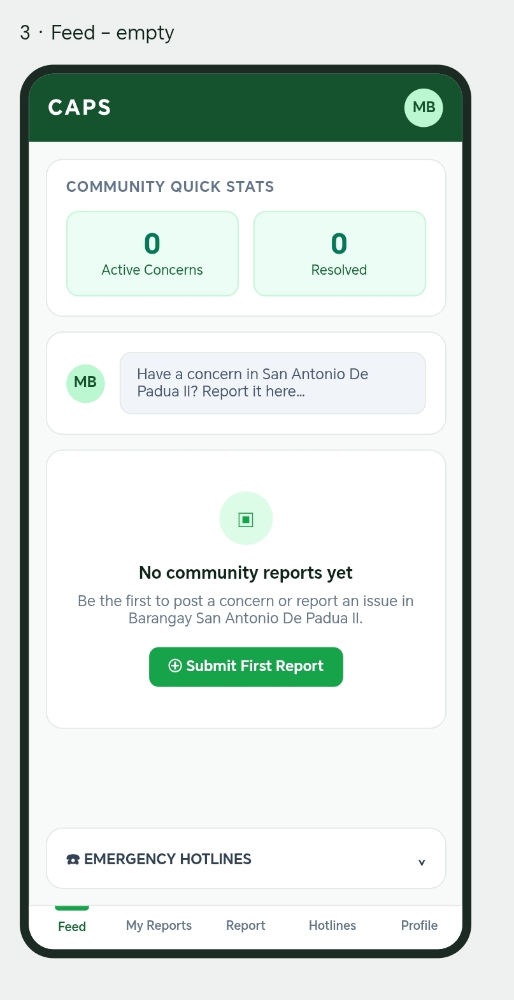
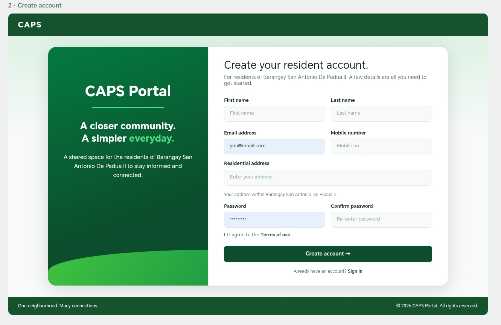

# CAPS Portal

A community reporting portal for **Barangay San Antonio De Padua II**.

> Final Project - SE Lab 2

---

## Description

CAPS Portal is a web application that lets residents of Barangay San Antonio De Padua II report local concerns such as broken streetlights, uncollected garbage, and safety hazards. Residents can follow the progress of their reports and discuss issues with their neighbors. The barangay admin reviews every report and updates its status until the concern is resolved.

The system replaces informal reporting (word of mouth, social media posts) with one organized place where every concern is recorded, tracked, and visible to the community.

## Objectives

### General Objective
To build a web-based portal that makes it easier for residents to report community concerns and for the barangay to respond to them.

### Specific Objectives
- To let residents register, log in, and submit reports with a category, description, purok, and photos.
- To give residents a community feed where they can search, upvote, and comment on reports.
- To let the admin view all reports in real time and update each report's status (Pending, Under Review, In Progress, Resolved).
- To notify residents when their report is updated or receives a comment or upvote, and to notify the admin when a new report is submitted.
- To protect user data with authentication and database security rules so each user can only do what their role allows.

## Features

### Residents
- Register and log in with email and password (with "Remember me")
- Submit reports with a category, title, description, purok, and up to 5 photos
- Browse the community feed and search reports by keyword or purok
- Upvote and comment on reports
- View and delete your own reports in **My Reports**
- Receive notifications for comments, upvotes, and status changes
- Edit your profile, upload a profile picture, and change your password

### Admin
- See every resident submission in real time
- Update a report's status: **Pending → Under Review → In Progress → Resolved**
- Delete reports and moderate (delete) comments
- Receive a notification whenever a new report is submitted

### Report Categories
Infrastructure, Waste Management, Public Safety, Emergency

## Technology Stack

| Layer | Technology |
|---|---|
| Front end | HTML, [Tailwind CSS](https://tailwindcss.com/) (CDN), JavaScript (ES modules), [Lucide](https://lucide.dev/) icons |
| Authentication | Firebase Authentication (email and password) |
| Database | Cloud Firestore (NoSQL) |
| Hosting | Firebase Hosting |
| Tools | Visual Studio Code, Git and GitHub, Firebase CLI |

Photos are compressed in the browser and stored as base64 in Firestore (`reports/{id}/media`), so Firebase Storage is not used.

## System Requirements

### To use the system
- A modern web browser (Google Chrome, Microsoft Edge, Firefox, or Safari)
- An internet connection

### To install and run it for development
- A Google account (for Firebase)
- [Node.js](https://nodejs.org/) (LTS version) and npm
- [Firebase CLI](https://firebase.google.com/docs/cli): `npm install -g firebase-tools`
- [Git](https://git-scm.com/)
- A code editor such as Visual Studio Code (optional: the Live Server extension)

## Installation Instructions

1. **Clone the repository**
   ```
   git clone <your-repository-url>
   cd <project-folder>
   ```
2. **Install the Firebase CLI** 
   ```
   npm install -g firebase-tools
   ```
3. **Log in to Firebase and select the project**
   ```
   firebase login
   firebase use <your-project-id>
   ```
4. **Add your Firebase configuration.** In the Firebase Console, open **Project settings → Your apps → Web app**, copy the config values, and paste them into `src/firebase-config.js`.
5. **Set the admin email.** In `src/firebase-config.js`, set `ADMIN_EMAIL` to the admin's email address. It must be identical to the email written in `database/firestore.rules`.

## Database Setup

The project uses **Cloud Firestore**, which has no SQL script to import. The collections are created automatically by the app when data is first saved. To set it up:

1. In the [Firebase Console](https://console.firebase.google.com/), open your project.
2. Go to **Build → Authentication → Sign-in method** and enable **Email/Password**.
3. Go to **Build → Firestore Database → Create database** and choose a location.
4. Deploy the security rules from this repository:
   ```
   firebase deploy --only firestore:rules
   ```
5. **Register the admin account first** from the register page, using the admin email. This account is the only one that can open the admin panel.

Collections used: `users`, `reports` (with a `media` subcollection), `comments`, and `notifications`.

- Full list of collections and fields: [`database/schema.md`](database/schema.md)
- Security rules: [`database/firestore.rules`](database/firestore.rules)

## How to Run the System

### Run locally
The pages use ES modules, so they must be served over HTTP (opening the HTML file directly will not work). From the project root:

```
firebase emulators:start --only hosting
```

Then open the address shown in the terminal (usually `http://localhost:5000`). Alternatively, open the `src/` folder in VS Code and use the **Live Server** extension.

### Deploy online
```
firebase deploy
```
`firebase.json` publishes the `src/` folder to Firebase Hosting.

### Using the system
- **Resident:** register an account, log in, and use the dashboard to submit and follow reports.
- **Admin:** log in with the admin email to open the admin panel.

## Screenshots
Empty for now we are collecting more screenshots

> Add your screenshots to `docs/Design/` and update the file names below.

| Page | Screenshot |
|---|---|
| Login |  |
| Register |  |
| Resident Dashboard (community feed) |  |
| Submit a Report |  |
| My Reports |  |
| Profile Settings |  |
| Admin Panel |  |

## Project Structure

```
SE LAB FINAL/
├── README.md
├── firebase.json            # Hosting and Firestore rules configuration
├── .firebaserc              # Firebase project (caps-portal)
├── .gitignore
├── docs/
│   ├── Requirements/        # Requirements documents
│   ├── Diagrams/            # Use case, ER / collection diagrams, flowcharts
│   ├── Design/              # UI mockups and screenshots
│   └── Testing/             # Test results and evidence
├── src/                     # The web application (deployed to Firebase Hosting)
│   ├── index.html           # Entry page (login)
│   ├── login.html
│   ├── register.html
│   ├── dashboard.html       # Community feed (residents)
│   ├── my-reports.html      # Resident's own reports
│   ├── profile.html         # Profile settings
│   ├── admin.html           # Admin panel
│   ├── 404.html
│   ├── caps-common.js       # Shared helpers (auth guard, notifications, photos)
│   └── firebase-config.js   # Firebase setup
├── tests/
│   └── test-cases.md        # Manual test cases
└── database/
    ├── firestore.rules      # Firestore security rules
    └── schema.md            # Description of all collections and fields
```

## Team Members

Joe Tykes S. Panti
Justine Kyle A. Santos
Bernardo Bantoc
Mark Baquirann
Marc Oliver Boneza
Jerome Espino